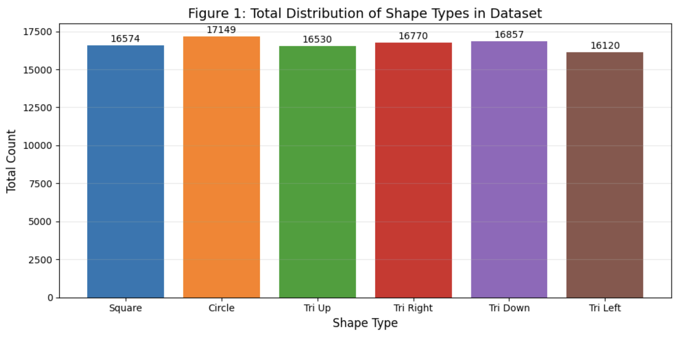
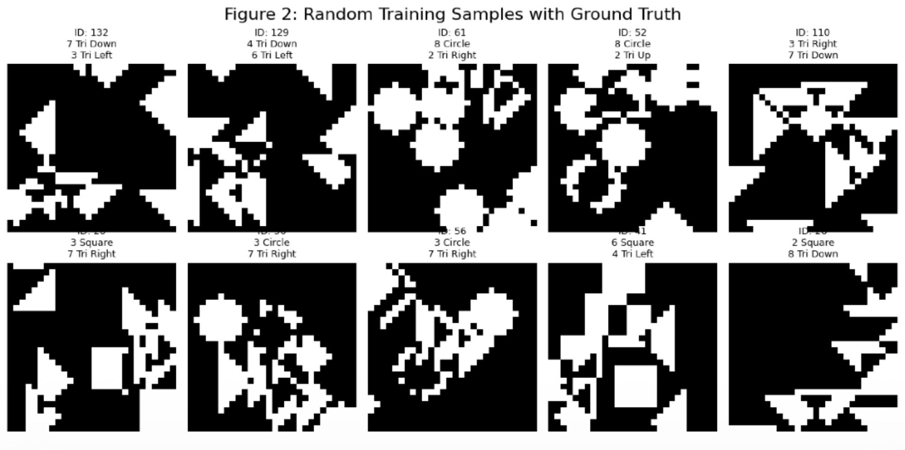
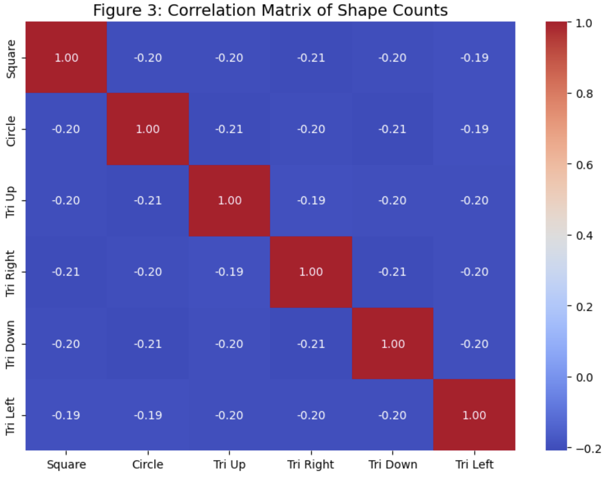
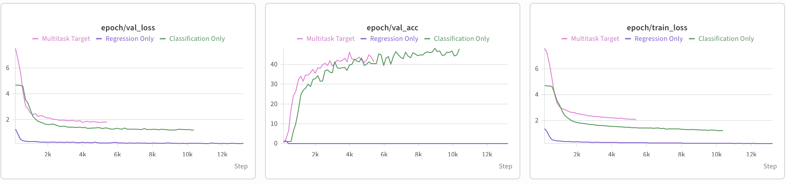

# Multitask Representation Learning for Geometric Spatial Vision


-lightgrey.svg)


## 1. Abstract & Objective

This project implements a Multi-Task Learning (MTL) architecture designed to resolve complex geometric spatial occlusion challenges. Given a single 28x28 grayscale input image containing multiple overlapping shapes, the network is trained to simultaneously solve two tasks:
1. **Classification:** Identify the exact global configuration of geometric shapes out of 135 possible classes.
2. **Regression:** Predict the precise count of 6 distinct shape categories (Square, Circle, and 4 rotational orientations of Triangles).

The core hypothesis verified in this repository is that forcing a shared CNN backbone to learn exact count regressions acts as a powerful regularizer for the high-dimensional classification task, preventing the network from overfitting to superficial overlapping pixel patterns.

## 2. Exploratory Data Analysis (EDA)
The dataset consists of 10,000 images, generated with strict balancing constraints where the total number of shapes per image always sums to 10. 

### Data Distribution & Visual Complexity
As shown in the overall distribution, the dataset maintains a near-uniform representation across all 6 shape types.



The primary computer vision challenge lies in **severe spatial occlusion**. Shapes heavily overlap, rendering deterministic pixel-area counting algorithms mathematically unviable. Furthermore, triangle orientation (Up, Down, Left, Right) is semantically discrete, requiring the model to maintain strict rotational sensitivity.



### Target Correlation
Analysis of the regression targets reveals specific anti-correlations dictated by the fixed sum constraint. 



## 3. Architecture Design
The system employs a **Shared Backbone with Task-Specific Heads** approach, optimized for Apple Silicon (MPS).

### 3.1 Feature Extractor
A deterministic 4-block Convolutional Neural Network (CNN) extracts spatial hierarchies.
- **Blocks:** 1 -> 8 -> 16 -> 32 -> 64 channels. 
- Each layer utilizes 3x3 kernels with padding = 1, followed by non-linear ReLU activations.
- The output is flattened into a 256-dimensional dense latent vector.

### 3.2 Task-Specific Heads
The shared representation is routed to parallel MLPs:
- **head_cls:** Linear mapping (256 -> 135) outputting Log-Softmax probabilities for NLLLoss.
- **head_cnt:** Linear mapping (256 -> 6) outputting continuous values for SmoothL1Loss.
- **Regularization:** Both heads utilize a strict Dropout rate of p=0.4 (empirically increased from 0.25 to combat early representation collapse).

### 3.3 Joint Objective Optimization
The network minimizes a weighted joint loss:

$$\mathcal{L}_{total} = \text{NLLLoss}(y_{cls}, \hat{y}_{cls}) + \lambda \cdot \text{SmoothL}_1\text{Loss}(y_{reg}, \hat{y}_{reg})$$

## 4. Label-Preserving Joint Augmentation Strategy
Standard geometric augmentations corrupt ground-truth data in orientation-sensitive regression tasks (e.g., rotating a "Triangle Up" trivially mutates it into a "Triangle Right"). To maintain strict label integrity, a custom synchronized `GSNDataset` loader was implemented:

1. **Horizontal Flip:** Flips the image tensor and explicitly swaps the count labels for "Right" and "Left" triangles.
2. **Vertical Flip:** Flips the image tensor and swaps "Up" and "Down" triangle labels.
3. **Discrete Rotation (90°):** Rotates the image by k * 90° and performs a cyclic permutation of the target vector indices for [Up, Right, Down, Left] by k steps.

This strategy forces rotational invariance for symmetric shapes (Circles, Squares) while teaching explicit rotational equivariance for directional triangles.

## 5. Benchmarks & Results
Three isolated experiments were conducted over 100 epochs using Early Stopping. The inclusion of the regression objective (λ = 2.0) significantly improved the validation accuracy and generalization of the classification head.



- **Experiment 1 (Classification Only, λ=0.0):** Model rapidly overfits to overlapping pixel clusters.
- **Experiment 2 (Regression Only, λ=1.0, cls=0.0):** Network converges well on counting but ignores global configurations.
- **Experiment 3 (Multitask Target, λ=2.0):** The regression error actively penalizes poor spatial feature extraction, leading to the highest classification accuracy and lowest validation loss.

## 6. Reproducibility & Deployment
This project uses `uv` for reproducible environment management and includes a `Makefile` for automated setup and execution.

```bash
# Clone and sync environment
git clone https://github.com/Pavelpuff/multitask-representation-learning.git
cd multitask-representation-learning
make setup

# Automatically fetch and extract GSN data
make download-data

# Run experiments from Section 5:
make train-cls  # Run Exp 1 (Classification Only)
make train-reg  # Run Exp 2 (Regression Only)
make train-mtl  # Run Exp 3 (Multitask Target - Best model)

# Or run all three sequentially
make train-all
```